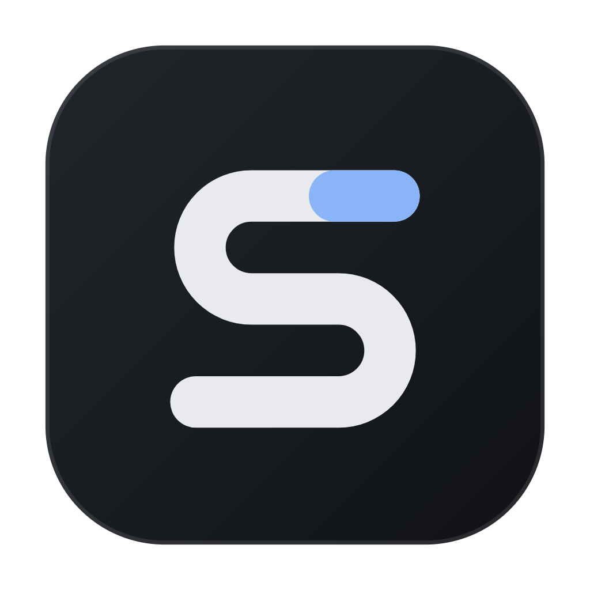

  

<h1 align="center">Slate Office</h1>

  A free, private office suite for Windows. Documents, spreadsheets, presentations and PDFs in one clean window, 
  with an AI assistant and voice typing that run on your own computer.

  <a href="https://github.com/kadenw213-svg/slate-office/releases/latest"><b>⬇ Download the latest version</b></a>

---

## What it is

Slate Office opens and edits the files you already use: Word, Excel, PowerPoint, PDF, plain text and images.
Everything sits in tabs in one window. It's free and open source, and it works without the internet.

- **Documents** (.docx, .odt, .rtf): page layout, headers and footers, comments, tracked changes, citations
  (MLA/APA/Chicago), table of contents, equations, and grammar checking.
- **Spreadsheets** (.xlsx, .csv, .ods): 140+ formulas, charts, filters, dropdowns, conditional formatting and pivot summaries.
- **Presentations** (.pptx): themes, transitions, speaker view, and presenting on a second screen.
- **PDFs**: edit existing text, highlight, draw, sign, fill forms, redact, merge, compress, password-protect,
  make scanned pages searchable (OCR), and convert to Word.
- **AI assistant**: highlight anything and press **Ctrl+J** to explain or summarize it, or just ask anything; it can
  check Wikipedia for facts. Ask it to edit in plain words ("comment on places where I use passive voice", "fix the
  grammar directly") and it leaves comments, tracked changes or direct edits. It can also make flashcards.
- **Voice typing** (**Ctrl+Alt+V**): talk, and Slate types for you anywhere.
- **Read aloud**, **split view**, a **command palette** (**Ctrl+Shift+P**), **version history**, autosave and crash recovery.

## How it works

- **Everything stays on your PC.** Files are opened and saved directly on your computer, and there's no account to make.
  Slate doesn't upload your documents anywhere.
- **The AI runs locally.** The first time you open the AI sidebar, Slate downloads a language model (1–5 GB) picked for
  your computer. After that it works offline. Voice typing works the same way, using a small speech model (40–250 MB).
- **Optional internet features are opt-in and minimal.** The AI can check Wikipedia for up-to-date facts (only the search
  words are sent, never your file), and the citation tool can look up a DOI or ISBN when you ask it to. Both can be
  turned off in Settings.
- **Cloud drives** like OneDrive, Google Drive and Dropbox show up on the Home screen through their own desktop sync apps.
- **Every feature has settings.** The basics are on by default, and **Settings → Advanced** shows every option.

## Download and install

1. Go to the [**latest release**](https://github.com/kadenw213-svg/slate-office/releases/latest) and download
   **`Slate-Office-Setup-x.y.z.exe`**.
2. Run it. Windows may show "Windows protected your PC" because the app isn't code-signed yet: click **More info → Run anyway**.
3. Pick where to install it, and you're done. Slate can open your files directly when you double-click them.

**Updating:** click the **S** logo at the top left, then **Check for updates**. A dot on the logo means a new version is ready.

**Requirements:** Windows 10 or 11 (64-bit). 8 GB of RAM or more is recommended for the AI assistant, and 16 GB+ for the largest AI model.

## Feedback

Found a bug or have an idea? In Slate, open **Settings → Feedback**, or [open an issue](https://github.com/kadenw213-svg/slate-office/issues).

---

Slate Office is open source under the [MIT licence](LICENSE). The AI models are Llama 3.2 (Llama 3.2 Community License)
and Qwen2.5 (Apache 2.0), and voice typing uses OpenAI Whisper (MIT). Building from source: see [docs/DEVELOPING.md](docs/DEVELOPING.md).
